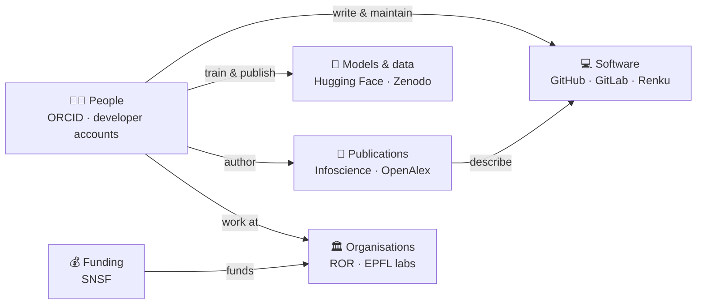

# What's inside Open Pulse

*No technical background needed. This page explains what information Open
Pulse holds, where it comes from, and why connecting it matters.*

Open Pulse is not just a list of code repositories or a library of papers.
It brings together **56 public sources** describing the whole life of
research — the **software** people write, the **AI models and datasets**
they publish, the **articles** they author, **who** they are, **where** they
work, and **who funds** them — and links all of it together so you can
follow the thread from one to the other.

:::info Numbers in this page
Counts are a snapshot from **November 2026** and grow as new data is
collected. Some sources overlap on purpose (for example *ORCID Switzerland*
includes the *ORCID EPFL* researchers), so the figures should not simply be
added up.
:::

## At a glance

| Kind of information | What you'll find | Roughly how much |
| --- | --- | --- |
| 💻 **Software & code** | Code repositories, projects and container images | ~130,000 projects |
| 🤖 **AI models & data** | Machine-learning models, datasets, research data deposits | ~28,000 items |
| 📄 **Publications** | Articles, theses, conference papers, journals | ~285,000 publications |
| 👩‍🔬 **People** | Researchers, developers and their career history | ~160,000 profiles |
| 🏛️ **Organisations** | Universities, labs, institutes, companies | ~125,000 organisations |
| 💰 **Funding** | Research grants | ~90,000 grants |

## 💻 Software & code

The code researchers write and share — the original focus of Open Pulse.

| Source | What it is | How many |
| --- | --- | --- |
| **GitHub** | The world's largest platform for sharing code. Includes repositories, the organisations that own them (labs, groups) and contributors. | ~125,000 repositories · ~1,600 organisations |
| **GitLab (EPFL, ETH Zurich, Data Science)** | The institutions' own code-hosting servers. | ~4,100 projects |
| **Renku** | The Swiss Data Science Center's platform for reproducible data-science projects. | ~1,200 projects |
| **Docker Hub** | Ready-to-run software packages ("container images"). | ~120 images |

For each project Open Pulse can show who contributed, how active it is,
which licence it uses, whether it is documented and tested, and which other
software depends on it.

## 🤖 AI models & research data

Research today produces far more than code and papers: trained AI models,
datasets and data deposits are first-class research outputs.

| Source | What it is | How many |
| --- | --- | --- |
| **Hugging Face** | The main hub for sharing AI. Includes **models** (trained AI systems), **datasets** used to train them, **spaces** (live demos) and the **papers** that describe them. | ~1,000 models · ~320 datasets · ~70 demos · ~270 papers |
| **Zenodo** | CERN's open repository where researchers archive software, datasets and other outputs and get a permanent citable identifier (DOI). Includes thematic **communities**. | ~6,800 records · ~850 communities |
| **SWISSUbase** | The Swiss national platform for social-science and humanities research data. | ~18,000 studies |
| **Renku data connectors** | Links from Renku projects to the data they use. | ~520 connectors |

## 📄 Publications

Scientific articles, theses and the venues that publish them.

| Source | What it is | How many |
| --- | --- | --- |
| **Infoscience** | EPFL's official repository of publications, theses and reports. | ~9,900 publications |
| **ETH Zurich Research Collection** | ETH Zurich's equivalent of Infoscience. | ~17,000 articles |
| **OpenAlex** | A global, open catalogue of scholarly works, with the **journals and venues** they appear in and the **topics and concepts** they cover. | ~158,000 works · ~282,000 venues · ~65,000 concepts · ~4,500 topics |
| **Open Access Monitor** | Tracks open-access publishing: publications, journals and publishers. | ~99,000 publications · ~25,000 journals · ~2,500 publishers |
| **EPFL Graph** | EPFL's own map of scientific disciplines. | ~2,200 disciplines |

The full text of Infoscience and Research Collection publications is also
split into **searchable passages** (about 460,000 of them), so you can search
*inside* papers by meaning, not just by title.

## 👩‍🔬 People

Who is behind the research — researchers, developers and their careers.

| Source | What it is | How many |
| --- | --- | --- |
| **ORCID** | The international ID that researchers use to sign their work. Includes their **employment** and **education** history. | ~72,000 Swiss researchers (~10,000 at EPFL) · ~180,000 employment records |
| **Infoscience & Research Collection** | Authors registered in the EPFL and ETH Zurich repositories. | ~6,900 EPFL · ~2,300 ETH Zurich |
| **OpenAlex authors** | Authors of the works in OpenAlex. | ~60,000 authors |
| **Developer accounts** | People's accounts on GitHub, GitLab and Renku. | ~22,000 accounts |

## 🏛️ Organisations

Where research happens — from whole universities down to individual labs.

| Source | What it is | How many |
| --- | --- | --- |
| **ROR** (Research Organization Registry) | The global registry giving every research organisation a unique ID. | ~125,000 worldwide (~1,850 in Switzerland) |
| **Infoscience & Research Collection** | EPFL and ETH Zurich labs, institutes and units. | ~600 EPFL · ~470 ETH Zurich |
| **OpenAlex institutions** | Institutions that appear on scholarly works. | ~1,700 institutions |

## 💰 Funding

| Source | What it is | How many |
| --- | --- | --- |
| **SNSF** (Swiss National Science Foundation) | Research grants awarded in Switzerland. | ~90,000 grants (~6,000 EPFL · ~7,900 ETH Zurich) |

## How it all connects

Collecting the data is only half the job. The real value of Open Pulse is
that it **links** these sources, so a single page can tell the whole story of
a piece of research.

Some of the links Open Pulse makes for you:

- **A developer and a researcher are the same person.** A GitHub account is
  matched to its owner's ORCID profile, so their code and their papers show
  up together.
- **Software and the papers about it.** When the authors of an article are
  also contributors to a repository, the two are linked — showing the
  academic impact of software that citation counts alone would miss.
- **Labs and institutions.** A GitHub organisation or an EPFL unit is linked
  to its official ROR identity, so activity rolls up correctly to the lab,
  the school and the institution.
- **Funding next to the work it pays for.** Each SNSF grant records its lead
  applicant, host institute, discipline and amount, so funding can be read
  alongside the labs and researchers doing the work.

Every item in Open Pulse also shows a **"Present in"** panel listing all the
sources that know about it, so you can see at a glance how widely a project,
a person or a lab is represented.

## Exploring it yourself

- Browse every source and its size on the hub's
  [Sources page](https://openpulse.epfl.ch/hub/sources) (sign-in required).
- Look up any repository, person, lab or record from the
  [hub search](https://openpulse.epfl.ch/hub) and follow the links between
  them.
- Curious about how the project's health is measured? See
  [Metrics and CHAOSS](../concepts/metrics-and-chaoss.md).
